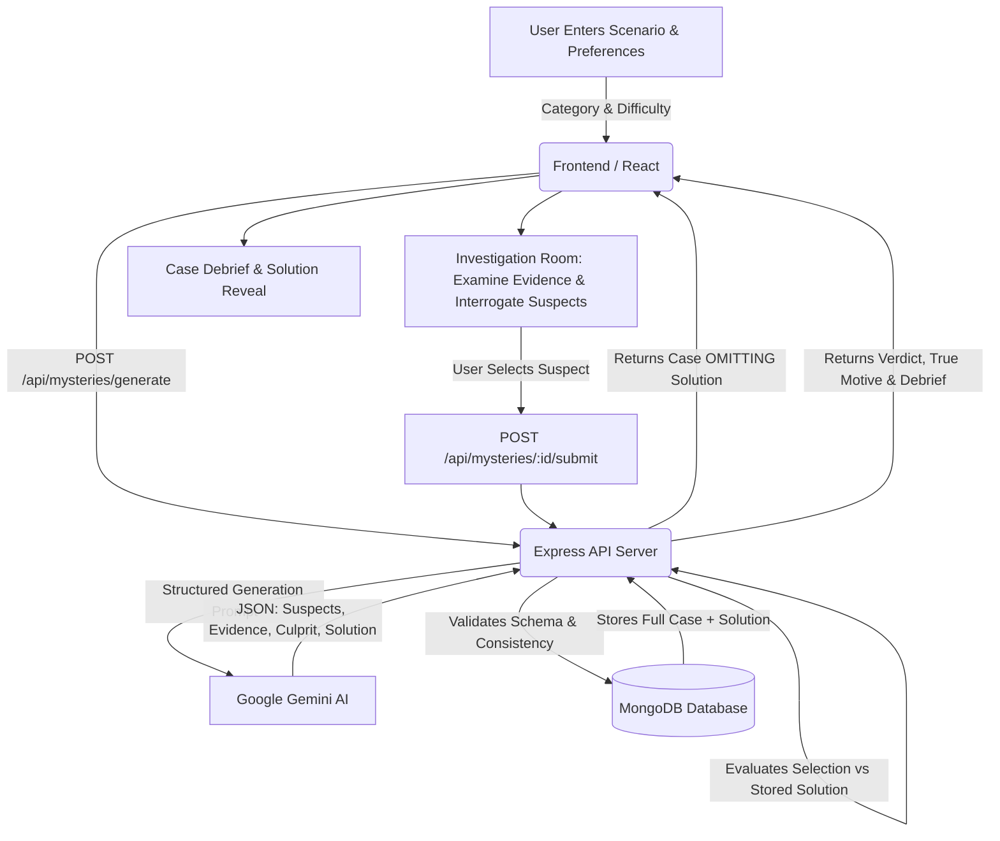

# 🔍 AI Mystery Room

[](https://www.mongodb.com/mern-stack)
[](https://nodejs.org/)
[](https://expressjs.com/)
[](https://react.dev/)
[](https://vitejs.dev/)
[](https://www.mongodb.com/)
[](https://ai.google.dev/)
[](https://opensource.org/licenses/MIT)

> **Step into the role of a lead detective.**  
> Provide any premise, scenario, or creative prompt, and watch as Google Gemini engineers a complete, logically airtight crime investigation — packed with suspects, multi-format evidence, alibis, contradictory timelines, and a single definitive culprit. Inspect clues, crack alibis, and reveal the truth!

---

## 📋 Table of Contents

- [Overview](#-overview)
- [How It Works](#-how-it-works)
- [Key Features](#-key-features)
  - [1. Dynamic AI Mystery Architect](#1-dynamic-ai-mystery-architect)
  - [2. Interactive Investigation Room](#2-interactive-investigation-room)
  - [3. Multi-Format Evidence System](#3-multi-format-evidence-system)
  - [4. In-Depth Suspect Profiling](#4-in-depth-suspect-profiling)
  - [5. Zero-Leak Anti-Spoil Security](#5-zero-leak-anti-spoil-security)
  - [6. Intelligent Culprit Evaluation & Case Debrief](#6-intelligent-culprit-evaluation--case-debrief)
  - [7. Dark Detective UI / UX](#7-dark-detective-ui--ux)
- [System Architecture](#-system-architecture)
- [Technology Stack](#-technology-stack)
- [Database Models & Schema](#-database-models--schema)
- [REST API Specification](#-rest-api-specification)
- [Project Directory Structure](#-project-directory-structure)
- [Getting Started & Installation](#-getting-started--installation)
  - [Prerequisites](#prerequisites)
  - [1. Clone & Environment Setup](#1-clone--environment-setup)
  - [2. Backend Setup](#2-backend-setup)
  - [3. Frontend Setup](#3-frontend-setup)
- [Environment Variables](#-environment-variables)
- [How to Play: Detective Guide](#-how-to-play-detective-guide)
- [Roadmap & Future Enhancements](#-roadmap--future-enhancements)
- [Contributing & License](#-contributing--license)

---

## 🔎 Overview

**AI Mystery Room** is a full-stack, AI-powered detective simulation web application built on the MERN stack (MongoDB, Express, React, Node.js) and powered by Google Gemini.

Traditional mystery games rely on pre-written, static scripts that players quickly exhaust. **AI Mystery Room** turns the player into both the commissioner of the story and the lead investigator. When a player supplies any brief scenario (e.g., *"A priceless ancient ruby disappears from an auction vault at midnight"*), the system's AI architect generates an intricate, internally consistent investigation:

- A vivid crime or incident summary with a specific location and timestamp.
- **3 to 5 realistic suspects**, each equipped with plausible motives, backgrounds, and alibis.
- **5 to 8 diverse clues and evidence items** spanning digital chats, surveillance footage, physical crime-scene photos, and forensic logs.
- One definitive, mathematically locked culprit with a genuine motive.
- Clever **red herrings** and misleading leads that challenge your deductive abilities without breaking logical consistency.

---

## 🔄 How It Works

The core loop follows an airtight, tamper-proof investigative flow:



### Core Philosophy
1. **Predetermined Truth**: The culprit and solution are decided *before* investigation starts. The game never "shifts the blame" based on user guesses.
2. **Logical Consistency**: All timestamps, statements, and clue relationships are cross-verified so that keen observation yields the correct answer.
3. **Zero Spoiler Leakage**: The solution never touches the browser's memory, state, or network packets until the final verdict is submitted.

---

## ✨ Key Features

### 1. Dynamic AI Mystery Architect
- **Google Gemini Engine**: Powered by Google's state-of-the-art multimodal reasoning models using strict JSON schema output mode.
- **Single-Pass Coherence**: Generates the incident, timeline, suspects, evidence, red herrings, and definitive solution simultaneously to prevent logical discrepancies.
- **Case Categories**:
  - 🩸 *Murder Mystery*
  - 💎 *Theft & Heist*
  - 🕵️ *Missing Person*
  - ⚠️ *Suspicious Incident*
  - 📜 *General Mystery*
- **Adaptive Difficulty Levels**:
  - **Easy**: Clear evidence trails, fewer suspects, obvious contradictions in alibis.
  - **Medium**: Balanced red herrings, subtle timeline inconsistencies, requires cross-referencing multiple clues.
  - **Hard**: Complex alibi networks, deceptive physical evidence, demands forensic scrutiny.

### 2. Interactive Investigation Room
- **Incident Briefing**: Comprehensive overview of the event, crime scene location, environmental factors, and time of occurrence.
- **Master Timeline Reconstructor**: Step-by-step chronology of verified events leading up to, during, and after the incident.
- **Case Evidence Locker**: Filter and inspect items by category (Chats, Photos, CCTV, Documents).
- **Suspect Gallery**: Side-by-side cards with immediate access to interrogation records and alibi statements.

### 3. Multi-Format Evidence System
Each mystery generates 5 to 8 pieces of varied, high-immersion evidence:
- 💬 **WhatsApp & Chat Logs**: Realistic messaging logs complete with timestamps, sender handles, and suspicious conversations.
- 📹 **CCTV & Security Records**: Simulated video camera feeds with camera IDs, timestamps, field-of-view observations, and security access logs.
- 📸 **Photographic Crime Scene Evidence**: Detailed visual artifacts (broken pocket watches, mud traces, shattered windows, misplaced belongings).
- 📑 **Official Documents & Statements**: Sworn witness testimonies, police preliminary reports, autopsy/forensics briefs, and keycard swipe logs.
- 🎣 **Explainable Red Herrings**: Deliberately suspicious evidence items designed to mislead careless investigators, with logical explanations revealed in the debrief.

### 4. In-Depth Suspect Profiling
Every generated suspect features a distinct profile:
- **Full Identity**: Name, age, profession, and physical or personality attributes.
- **Relationship to Incident**: Connection to the victim, crime scene, or valuable asset.
- **Plausible Motive**: Financial gain, revenge, passion, jealousy, or cover-up.
- **Claimed Alibi**: What they claim to have been doing and where, ready to be corroborated or debunked by the timeline and evidence.

### 5. Zero-Leak Anti-Spoil Security
- The backend sanitizes every API response before sending it to the client.
- The `solution` object (culprit ID, key evidence, and motive) is completely stripped out of `GET /api/mysteries/:id`.
- Curious users inspecting browser DevTools or Network tabs **cannot** uncover the culprit prematurely.

### 6. Intelligent Culprit Evaluation & Case Debrief
- **Accusation Submission**: Once confident, the investigator chooses one suspect and locks in their accusation.
- **Instant Backend Evaluation**: The server compares the submitted `selectedSuspectId` directly against the stored solution.
- **Comprehensive Case Debrief**:
  - ✅ **Verdict**: Clear Correct or Incorrect outcome.
  - 👤 **True Culprit**: Identity, role, and true motive.
  - 🧩 **The Smoking Gun**: The critical pieces of evidence that cracked the case.
  - 🔍 **Deconstruction of Misleading Clues**: Detailed breakdown explaining why red herrings seemed guilty but were ultimately innocent.
  - 📖 **Complete Case Narrative**: A beginner-friendly walkthrough of the crime from planning to execution.

### 7. Dark Detective UI / UX
- **Atmospheric Palette**: Deep charcoals, midnight slate, muted caution crimson, and high-contrast typography.
- **Board-Style Layout**: Feels like examining an actual detective's corkboard with pin-up cards, photos, and files.
- **Responsive Design**: Clean experience across desktop monitors, laptops, tablets, and mobile devices.

---

## 🏛️ System Architecture

AI Mystery Room follows a clean, decoupled **Three-Tier MERN Architecture**:

```text
┌────────────────────────────────────────────────────────────────────────┐
│                        CLIENT LAYER (React 19 + Vite)                  │
│   - Homepage (Scenario Input)         - Investigation Room UI          │
│   - Suspects & Evidence Modals        - Case Debrief & Result Modal    │
└───────────────────────────────────┬────────────────────────────────────┘
                                    │ HTTP / JSON REST APIs
                                    ▼
┌────────────────────────────────────────────────────────────────────────┐
│                        SERVER LAYER (Express.js)                       │
│   Routes (api/mysteries) ──► Controllers ──► Middleware (Error/Valid)   │
│                                    │                                   │
│                        Services (Gemini AI API)                        │
└───────────────────────────────────┬────────────────────────────────────┘
                                    │ Mongoose ODM
                                    ▼
┌────────────────────────────────────────────────────────────────────────┐
│                        DATABASE LAYER (MongoDB)                        │
│   - Mystery Collection: Schemas for Incidents, Suspects, Evidence,     │
│     Timelines, and Protected Solutions                                │
└────────────────────────────────────────────────────────────────────────┘
```

### Layered Separation of Responsibilities
- **Routes (`server/routes/`)**: Declares API routes and maps them to controllers with input validators.
- **Controllers (`server/controllers/`)**: Handles request parameters, delegates to services, sanitizes data, and formats unified JSON responses.
- **Services (`server/services/`)**: Interfaces with external providers like the Google Gemini API.
- **Models (`server/models/`)**: Mongoose data definitions enforcing data integrity and type constraints.
- **Middleware (`server/middleware/`)**: Centralized error interceptor, async wrappers, and schema validators.

---

## 🛠️ Technology Stack

| Layer | Technology | Purpose |
|---|---|---|
| **Frontend UI** | **React 19** | Component-driven user interface and dynamic state management |
| **Build Tool** | **Vite 8** | Lightning-fast development server and optimized production bundler |
| **Styling** | **CSS3 (Custom Theme)** | Detective-themed dark UI, responsive grid and flexbox layouts |
| **Backend API** | **Node.js 18+ & Express 5** | High-performance RESTful API service |
| **Database** | **MongoDB & Mongoose 9** | NoSQL document storage and robust schema validation |
| **AI Provider** | **Google Gemini** | Structured scenario creation, evidence synthesis, and mystery generation |
| **Security & CORS** | **dotenv, cors** | Environment management and cross-origin security controls |

---

## 🗄️ Database Models & Schema

The core collection is **`Mystery`** managed via Mongoose:

```javascript
// Suspect Schema
{
  id: String,          // Unique ID (e.g. "suspect_1")
  name: String,        // Full name
  age: Number,         // Age
  occupation: String,  // Occupation/Role
  background: String,  // Background story
  motive: String,      // Potential reason for involvement
  alibi: String,       // Claimed location & activity
  personality: String  // Personality traits & demeanor
}

// Evidence Schema
{
  id: String,          // Unique ID (e.g. "evidence_1")
  type: String,        // 'chat' | 'image' | 'cctv' | 'document' | 'statement'
  title: String,       // Clue title
  description: String, // Context and detective notes
  content: Mixed,      // Text, chat messages array, or media payload
  relatedSuspectIds: [String], // Referenced suspects
  relevance: String,   // Investigative significance
  timestamp: Date      // Evidence discovery or creation time
}

// Master Mystery Schema
{
  title: String,
  category: String,    // 'murder' | 'theft' | 'missing' | 'suspicious' | 'general'
  difficulty: String,  // 'easy' | 'medium' | 'hard'
  incident: {
    description: String,
    location: String,
    dateTime: Date
  },
  suspects: [suspectSchema],
  timeline: [{
    time: String,
    event: String
  }],
  evidence: [evidenceSchema],
  solution: {          // PROTECTED: Stripped from public responses
    culpritId: String,
    motive: String,
    explanation: String,
    keyEvidenceIds: [String],
    misleadingClues: [String]
  },
  createdAt: Date,
  updatedAt: Date
}
```

---

## 📡 REST API Specification

All endpoints adhere to a standardized, predictable JSON envelope:

```json
// Success Response
{
  "success": true,
  "data": { ... },
  "message": "Request successful"
}

// Error Response
{
  "success": false,
  "message": "Detailed error explanation",
  "code": "ERROR_CODE"
}
```

### Endpoints Overview

#### 1. Generate Mystery
- **Route**: `POST /api/mysteries/generate`
- **Description**: Submits a prompt scenario to Google Gemini, validates the structured mystery, stores it in MongoDB, and returns the public case file (solution omitted).
- **Request Body**:
  ```json
  {
    "scenario": "A tech CEO is found unconscious in an encrypted server room right after a source-code breach.",
    "category": "theft",
    "difficulty": "medium"
  }
  ```
- **Response**: `200 OK` with generated mystery details (excluding `solution`).

#### 2. Get Mystery Case File
- **Route**: `GET /api/mysteries/:id`
- **Description**: Retrieves all public details, suspects, timeline, and evidence for an ongoing investigation.
- **Security**: The `solution` field is strictly omitted from the returned object.

#### 3. Inspect Specific Evidence
- **Route**: `GET /api/mysteries/:id/evidence/:evidenceId`
- **Description**: Fetches granular data, chat logs, or media links for a specific piece of evidence.

#### 4. Submit Accusation
- **Route**: `POST /api/mysteries/:id/submit`
- **Description**: The investigator submits their final choice for the culprit. The server evaluates it against `solution.culpritId`.
- **Request Body**:
  ```json
  {
    "selectedSuspectId": "suspect_2"
  }
  ```
- **Response**:
  ```json
  {
    "success": true,
    "data": {
      "isCorrect": true,
      "culprit": "suspect_2",
      "motive": "Facing bankruptcy, they stole the proprietary algorithms to sell to a competitor.",
      "explanation": "Security logs showed suspect_2's keycard was used simultaneously with the firewall breach.",
      "keyEvidenceIds": ["evidence_1", "evidence_4"],
      "misleadingClues": [
        "Suspect 1's spilled coffee appeared suspicious, but was an accidental distraction."
      ]
    },
    "message": "Correct answer"
  }
  ```

#### 5. Retrieve Completed Case Result
- **Route**: `GET /api/mysteries/:id/result`
- **Description**: Retrieves the full solution dossier once the investigation is submitted or concluded.

---

## 📂 Project Directory Structure

```text
AI Mystery room/
├── spec.md                     # Master Technical & Requirements Specification (SSOT)
├── README.md                   # Complete Project Documentation & User Guide
│
└── ai-mystery-room/            # Primary Application Root
    ├── .env                    # Environment configuration (Local credentials)
    ├── .env.example            # Sample environment template
    ├── README.md               # Subproject documentation
    │
    ├── client/                 # React 19 + Vite Frontend
    │   ├── index.html          # HTML entry point
    │   ├── package.json        # Frontend scripts and dependencies
    │   ├── vite.config.js      # Vite build configuration
    │   └── src/
    │       ├── assets/         # Images, icons, and static graphics
    │       ├── App.jsx         # Main application container
    │       ├── App.css         # Application component styling
    │       ├── index.css       # Global styles and typography
    │       └── main.jsx        # React root mounting
    │
    └── server/                 # Node.js + Express 5 Backend
        ├── package.json        # Backend dependencies & scripts
        ├── server.js           # Server bootstrap and MongoDB connection
        ├── app.js              # Express app setup and middleware routing
        ├── test.js             # Testing suite
        ├── config/             # Environment and external service configs
        ├── controllers/
        │   └── mysteryController.js # API request handling and solution protection
        ├── middleware/
        │   ├── errorHandler.js      # Centralized error handler
        │   └── asyncHandler.js      # Async controller wrapper
        ├── models/
        │   └── Mystery.js           # Mongoose schema for mysteries
        ├── routes/
        │   └── mysteries.js         # API route endpoints
        ├── services/
        │   └── geminiService.js     # Google Gemini API integration
        └── validators/
            └── mysteryValidators.js # Input sanitization and validators
```

---

## 🚀 Getting Started & Installation

### Prerequisites
Before running the application, make sure you have:
1. **Node.js**: `v18.0.0` or later installed ([Download Node.js](https://nodejs.org/)).
2. **MongoDB**: A running MongoDB instance locally or a free [MongoDB Atlas](https://www.mongodb.com/atlas) connection URI.
3. **Google Gemini API Key**: A free API key from [Google AI Studio](https://aistudio.google.com/).

---

### 1. Clone & Environment Setup

1. Open your terminal and navigate to the project directory:
   ```bash
   cd "AI Mystery room/ai-mystery-room"
   ```

2. Create your `.env` file from the provided `.env.example`:
   ```bash
   cp .env.example .env
   ```

3. Fill in your credentials inside `ai-mystery-room/.env`:
   ```env
   PORT=5000
   MONGODB_URI=mongodb+srv://<username>:<password>@cluster0.mongodb.net/ai_mystery_room
   GEMINI_API_KEY=your_actual_gemini_api_key
   GEMINI_MODEL=gemini-2.5-flash
   CLIENT_URL=http://localhost:5173
   ```

---

### 2. Backend Setup

1. Open a terminal and navigate to the server directory:
   ```bash
   cd server
   ```

2. Install dependencies:
   ```bash
   npm install
   ```

3. Start the Express backend server:
   ```bash
   node server.js
   ```
   *The server will connect to MongoDB and start listening on `http://localhost:5000`.*

---

### 3. Frontend Setup

1. Open a new terminal and navigate to the client directory:
   ```bash
   cd client
   ```

2. Install dependencies:
   ```bash
   npm install
   ```

3. Start the Vite development server:
   ```bash
   npm run dev
   ```

4. Open your browser and navigate to the URL shown in the terminal:
   ```text
   http://localhost:5173
   ```

---

## ⚙️ Environment Variables

| Variable | Description | Example |
|---|---|---|
| `PORT` | Port for the Express backend | `5000` |
| `MONGODB_URI` | MongoDB connection string (Atlas or Local) | `mongodb://localhost:27017/ai_mystery` |
| `GEMINI_API_KEY` | Google Gemini API key (kept confidential on server) | `AIzaSyD...` |
| `GEMINI_MODEL` | Gemini model used for story and case generation | `gemini-2.5-flash` |
| `CLIENT_URL` | Allowed origin for CORS | `http://localhost:5173` |

> ⚠️ **Security Warning**: Never commit your `.env` file to version control. The Gemini API key must always remain strictly on the backend.

---

## 🎮 How to Play: Detective Guide

```text
[Step 1: The Case Commission]
Enter any premise: "A luxury yacht arrives at the harbor with no captain and an open safe."
Choose Category: Theft | Difficulty: Hard
Click "Generate Case" ➔ Gemini synthesizes the scenario.

[Step 2: Enter the Crime Scene]
Review the Incident Dossier: Time of crime, location, and the initial report.
Read through the Timeline to understand everyone's whereabouts.

[Step 3: Interrogate Suspects]
Read their profiles: What is their motive? What are their claimed alibis?
Who had the access, the motive, and the opportunity?

[Step 4: Examine Evidence]
Inspect WhatsApp conversations: Do message timestamps contradict their alibi?
Check CCTV footage: Did someone claim they were asleep when a camera caught them?
Inspect physical crime scene photos for forensic clues.

[Step 5: File Your Accusation]
Select the suspect you believe is responsible.
Confirm your choice.
Read the Case Debrief to see if your deduction was flawless!
```

---

## 🔮 Roadmap & Future Enhancements

- [ ] **Multiplayer Detective Co-op**: Investigate the case together with friends in a shared live room.
- [ ] **AI-Synthesized Voice Interrogations**: Directly talk to or interrogate suspects using Gemini Live / Audio generation.
- [ ] **Dynamic AI Image Generation**: Integrated Imagen generation for authentic photorealistic crime scene photos.
- [ ] **Detective Score & Leaderboard**: Earn detective badges (e.g., *Rookie Constable*, *Sherlock Holmes*) based on clues needed and accuracy.
- [ ] **Interactive Hint System**: Request subtle hints from a digital police chief if stuck on hard cases.
- [ ] **Community Mystery Gallery**: Save and share generated cases with other players to see if they can solve them.

---

## 📄 Contributing & License

Contributions, feature suggestions, and bug reports are welcome!

1. Fork the Project.
2. Create your Feature Branch (`git checkout -b feature/NewDetectiveTool`).
3. Commit your Changes (`git commit -m 'Add NewDetectiveTool'`).
4. Push to the Branch (`git push origin feature/NewDetectiveTool`).
5. Open a Pull Request.

Distributed under the **MIT License**. See `LICENSE` for more information.

---

<p align="center">
  <b>Built with ❤️ for mystery and detective enthusiasts worldwide.</b>
</p>

